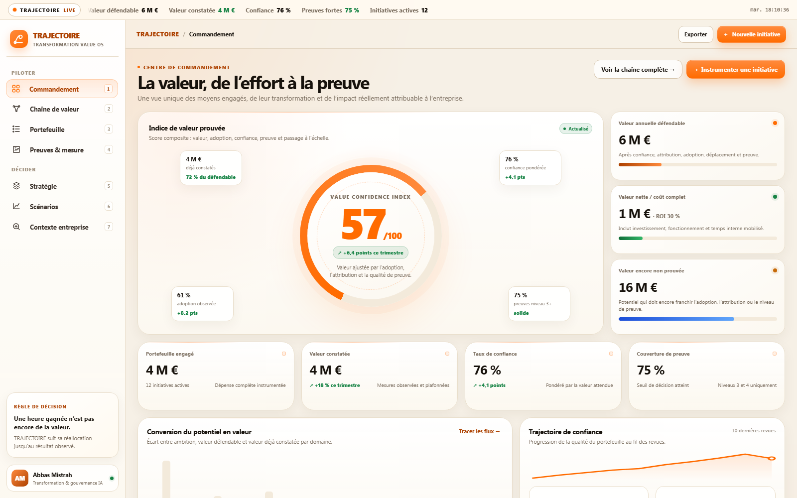
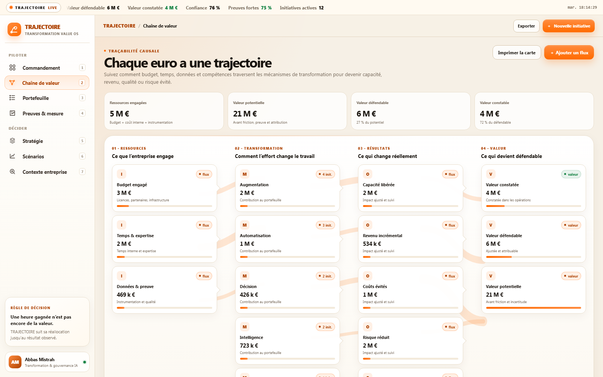
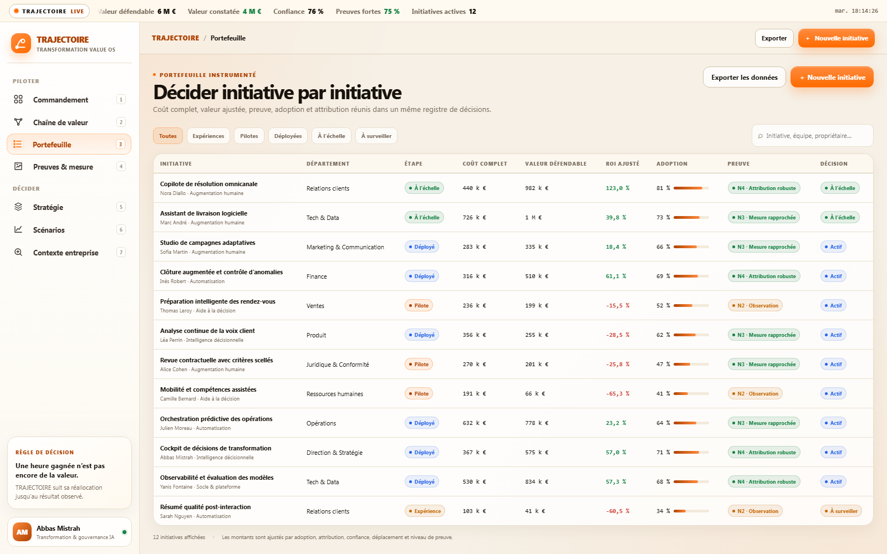
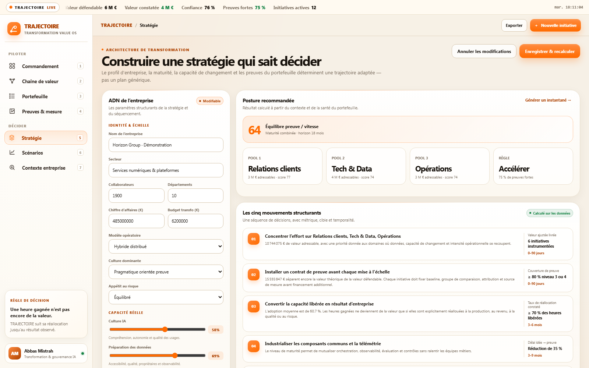
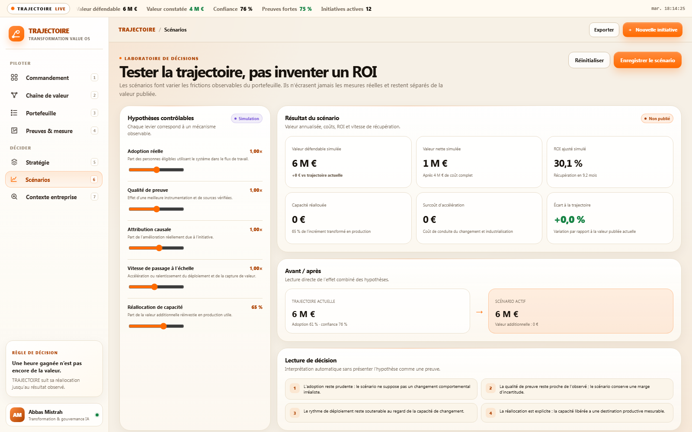

# TRAJECTOIRE

**Transformation Value OS — du temps investi à la valeur prouvée.**

TRAJECTOIRE est un logiciel local-first de pilotage de la transformation. Il relie les ressources engagées, les changements de travail, les résultats observés et la valeur réellement attribuable à l’entreprise.

Ce n’est pas un calculateur de ROI. Un calculateur transforme des hypothèses en un chiffre. TRAJECTOIRE transforme un portefeuille d’initiatives en un système de décisions : chaque valeur publiée conserve sa baseline, sa source, son niveau de preuve, son taux d’adoption, son attribution et son coût complet.



## Ce que le produit résout

Les programmes de transformation savent généralement compter les projets, les licences, les personnes formées ou les heures « gagnées ». Ils peinent à répondre à quatre questions plus importantes :

1. Où l’effort est-il réellement parti ?
2. Quel travail a été transformé ?
3. Quel résultat observable a changé ?
4. Quelle part de cette amélioration peut raisonnablement être attribuée à l’initiative ?

TRAJECTOIRE installe cette continuité de preuve dans un seul produit.

## Sept surfaces de décision

| Surface | Décision rendue possible |
|---|---|
| **Commandement** | Lire en une minute la valeur défendable, constatée, nette et encore fragile. |
| **Chaîne de valeur** | Suivre chaque ressource de l’effort jusqu’à la valeur, sans double comptage. |
| **Portefeuille** | Financer, renforcer, fusionner, redessiner ou arrêter une initiative. |
| **Preuves & mesure** | Conserver baselines, observations, sources, confiance et attribution. |
| **Stratégie** | Générer une trajectoire adaptée à la taille, la culture, la maturité et aux contraintes de l’entreprise. |
| **Scénarios** | Tester les effets de l’adoption, de la preuve, de l’attribution et de la vitesse sans les confondre avec les résultats réels. |
| **Contexte entreprise** | Relier métiers, psychologie organisationnelle, données, capacité de changement et sources de contexte. |

### Chaîne de valeur



### Portefeuille instrumenté



### Stratégie calculée sur le contexte



### Scénarios séparés des preuves



## Modèle de valeur

Pour chaque initiative, le moteur distingue :

- **coût complet** = investissement + fonctionnement + temps interne mobilisé ;
- **valeur potentielle** = résultat annuel avant friction ;
- **valeur défendable** = potentiel × confiance × attribution × adoption × (1 − déplacement) × qualité de preuve ;
- **valeur constatée** = mesure observée, plafonnée par la valeur défendable ;
- **valeur nette** = valeur défendable − coût complet ;
- **ROI ajusté** = valeur nette / coût complet.

Le détail, les garde-fous et les règles anti-double-comptage sont documentés dans [docs/METHODOLOGY.md](docs/METHODOLOGY.md).

## Fonctionnalités

- base SQLite locale créée automatiquement ;
- jeu de démonstration entièrement fictif et anonymisé ;
- création d’initiatives et calcul immédiat du coût complet ;
- ajout de mesures et de preuves vérifiées ;
- recalcul du portefeuille après chaque observation ;
- stratégie déterministe fondée sur le profil réel de l’entreprise ;
- laboratoire de scénarios isolé des chiffres publiés ;
- export JSON complet et CSV du portefeuille ;
- journal d’audit local ;
- PWA installable et fonctionnement hors connexion pour l’interface ;
- aucun service cloud ni traqueur nécessaire.

## Démarrage

Prérequis : **Node.js 22.5 ou supérieur**. Aucune dépendance à installer.

```bash
npm start
```

Puis ouvrir [http://127.0.0.1:4310](http://127.0.0.1:4310).

Sous Windows, `launch-trajectoire.ps1` démarre le serveur en arrière-plan et ouvre une fenêtre Chrome dédiée :

```powershell
powershell -ExecutionPolicy Bypass -File .\launch-trajectoire.ps1
```

Pour créer le raccourci Bureau :

```powershell
powershell -ExecutionPolicy Bypass -File .\scripts\install-desktop.ps1
```

L’application peut également être installée comme PWA depuis Chrome via **Installer l’application**.

## Vérification

```bash
npm run check
npm test
```

Les tests couvrent le coût complet, l’ajustement de valeur, l’agrégation du portefeuille, la priorisation des départements et le moteur de stratégie.

## Architecture

```text
Navigateur / PWA
      │
      ├── tableaux de bord et interactions
      ├── cache hors connexion de l’interface
      │
API HTTP locale (Node.js, sans framework)
      │
      ├── moteur de valeur et de stratégie
      ├── exports JSON / CSV
      └── journal d’audit
      │
SQLite local
      ├── organisations et départements
      ├── initiatives et mesures
      ├── preuves et sources de contexte
      └── instantanés de stratégie
```

Voir [docs/ARCHITECTURE.md](docs/ARCHITECTURE.md) pour le schéma de données, les routes et les choix de sécurité.

## Données et confidentialité

- La base est enregistrée dans `data/trajectoire.db` et exclue de Git.
- Une nouvelle base reçoit uniquement des données de démonstration fictives.
- Aucun secret, donnée réelle d’entreprise ou connecteur externe n’est inclus.
- Le module de contexte n’invente aucune recherche : seules les sources explicitement enregistrées influencent la stratégie.

## Positionnement

TRAJECTOIRE complète un cockpit d’adoption ou de delivery : il ne demande pas seulement « combien utilisent l’IA ? », mais « qu’est devenue la capacité créée, comment le savons-nous et quelle décision prenons-nous maintenant ? »

---

Conçu par **Abbas Mistrah** — Direction de la transformation IA, stratégie, gouvernance et delivery.

Licence MIT.
